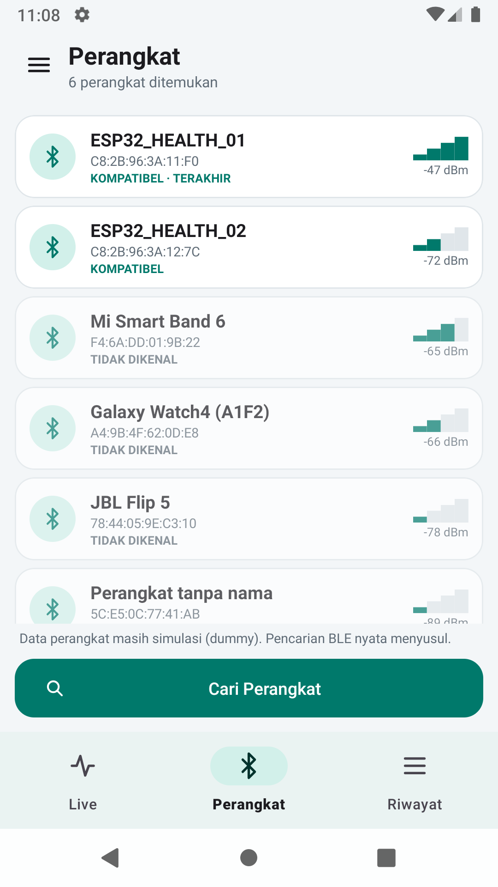
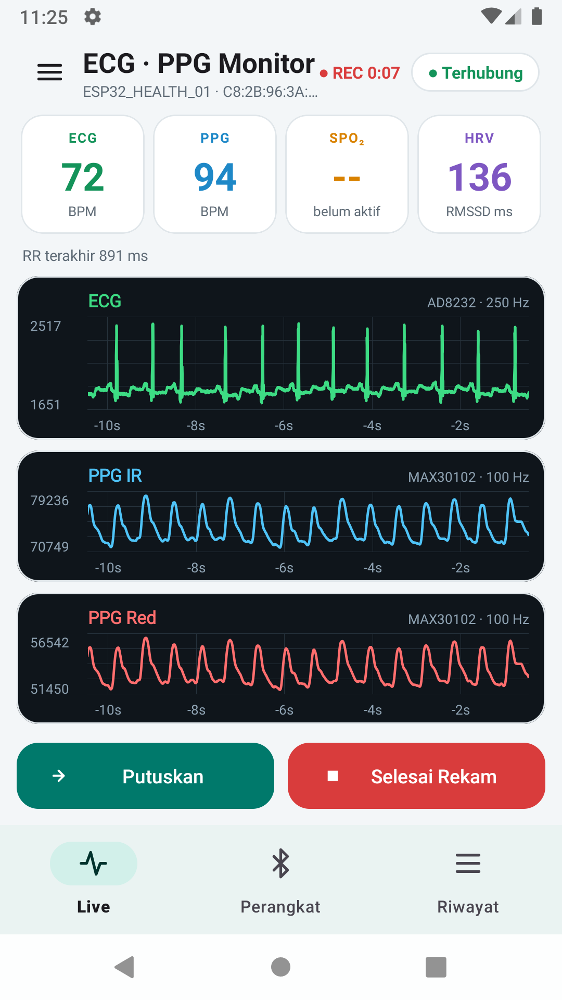
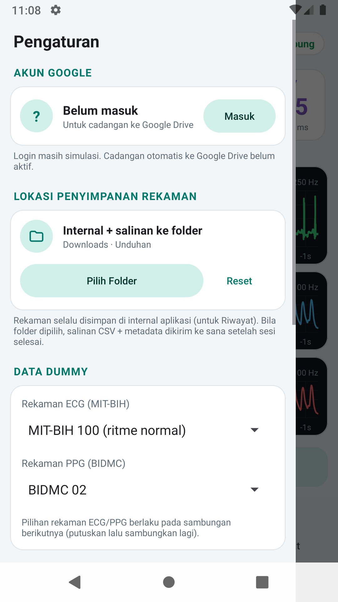
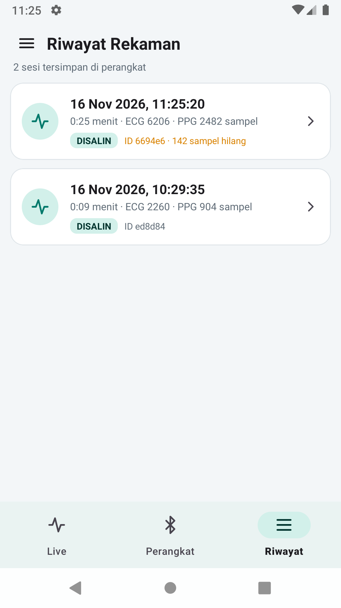
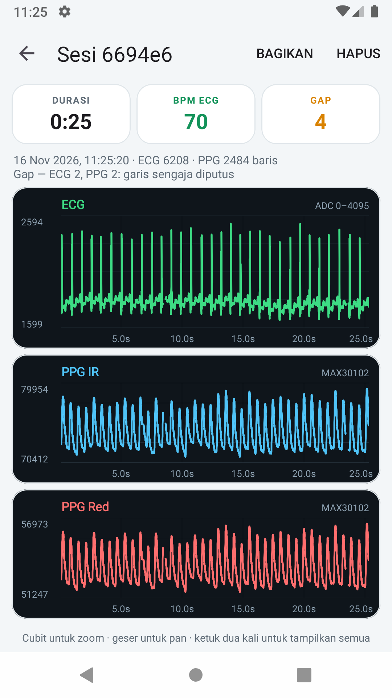
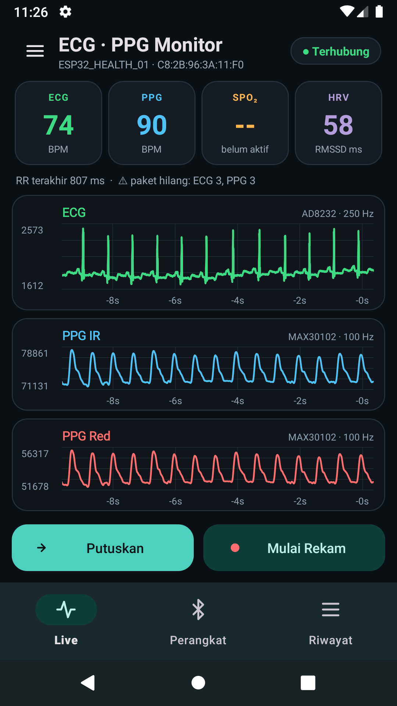

# ECG-PPG — Monitor EKG & PPG Portabel (Purwarupa Android)

Purwarupa sistem pemantauan **EKG satu kanal (AD8232)** dan **PPG dua kanal (MAX30102)** berbasis **ESP32**, dengan aplikasi **Android native (Kotlin)** untuk menampilkan grafik *real-time*, menghitung detak jantung, merekam sesi ke CSV, dan memutar ulang rekaman.

> **Bukan alat medis.** Proyek pembelajaran/penelitian. Tidak ada diagnosis, klaim akurasi klinis, maupun alarm medis. Tidak memakai *machine learning* — semua pengolahan sinyal bersifat klasik (DSP).

## Status

Perangkat keras belum dirakit, sehingga aplikasi dikembangkan dan diuji lebih dulu dengan **data dummy** dari dataset publik (MIT-BIH untuk ECG, BIDMC untuk PPG) melalui antarmuka sumber data yang kelak diganti sumber BLE.

| Bagian | Status |
|---|---|
| Aplikasi Android (live, rekam CSV, riwayat, replay, salin ke folder, tema) | Selesai (data dummy) |
| DSP: R-peak, BPM ECG/PPG, interval RR, RMSSD | Selesai, divalidasi pada dataset |
| Pencarian perangkat BLE | Simulasi (antarmuka `DeviceScanner` siap diganti) |
| Login Google / pencadangan Drive | Simulasi / rencana |
| SpO₂ | Rencana (butuh data nyata dua kanal + kalibrasi) |
| Firmware ESP32, BLE nyata, perakitan | Rencana |

## Fitur aplikasi

- **Live**: grafik ECG, PPG IR, PPG Red; BPM ECG/PPG, RMSSD, status *lead-off* dan jari; tombol rekam.
- **Perangkat**: pencarian perangkat BLE (simulasi) dengan kekuatan sinyal dan lencana kompatibilitas.
- **Riwayat & Detail**: daftar sesi, rekonstruksi grafik dari CSV dengan zoom/geser, celah data tampil sebagai garis putus.
- **Pengaturan** (slide samping): akun Google (simulasi), lokasi penyimpanan rekaman (salinan ke folder pilihan via Storage Access Framework), pilihan data dummy, simulasi paket hilang / elektroda terlepas, tema Sistem/Terang/Gelap.
- **Rekaman**: satu sesi = satu CSV (format *long/sparse*, timestamp dari perangkat) + metadata JSON; deteksi paket hilang.

## Tangkapan layar

| Perangkat | Live (merekam) | Pengaturan |
|---|---|---|
|  |  |  |

| Riwayat | Detail rekaman | Mode gelap |
|---|---|---|
|  |  |  |

## Hasil validasi algoritma

Detektor yang sama dengan di aplikasi, diuji pada dataset publik (skrip dan hasil mentah di [`doc/validasi/`](doc/validasi)):

| Uji | Hasil |
|---|---|
| ECG — 44 rekaman MIT-BIH (100.653 detak, toleransi ±150 ms) | Sensitivitas **98,66%**, prediktivitas positif **99,50%** |
| PPG — 52 rekaman BIDMC (BPM vs HR referensi) | MAE rata-rata **3,28 BPM** (median 2,06); 81,6% titik dalam ±5 BPM |

Hasil pada data dummy **tidak** menjamin akurasi pada sensor AD8232/MAX30102 nyata; validasi pada perangkat keras tetap diperlukan.

## Build dan menjalankan

Prasyarat: Android Studio (JDK 17), Android SDK. Aplikasi memakai SDK minimum 24 dan diuji pada emulator Android 9 (API 28).

```bash
./gradlew assembleDebug          # APK: app/build/outputs/apk/debug/app-debug.apk
./gradlew testDebugUnitTest      # uji unit DSP pada data dummy
```

Atau buka folder ini di Android Studio dan jalankan konfigurasi `app`. Tidak ada pustaka pihak ketiga tambahan (grafik digambar dengan `Canvas`).

### Membuat ulang aset data dummy

Aset di `app/src/main/assets/dummy/` adalah kutipan 90 detik dari dataset publik yang sudah dikonversi (ECG 250 Hz, PPG 100 Hz). Untuk membuat ulang dari berkas zip dataset:

```bash
python3 tools/make_dummy_assets.py <mitdb-1.0.0.zip> <bidmc-ppg-and-respiration-dataset-1.0.0.zip> app/src/main/assets/dummy
```

Kanal **Red** pada data dummy bersifat **sintetis** (BIDMC hanya punya satu kanal PPG), sehingga SpO₂ tidak dapat dihitung dari data ini.

## Struktur proyek

```text
app/src/main/java/com/example/myapplication/
├── MainActivity.kt, MonitorEngine.kt, App.kt   # navigasi, pusat data live, rekaman
├── data/    # SignalSource, DeviceScanner, Series, rekaman CSV, StorageExporter, Prefs
├── dsp/     # RPeakDetector, PpgPeakDetector, RateTracker
└── ui/      # WaveformView, Live/Devices/History/Settings, DetailActivity
app/src/main/assets/dummy/   # data dummy (MIT-BIH, BIDMC)
app/src/test/                # uji unit DSP
tools/                       # skrip pembuat aset dummy
doc/                         # dokumentasi, proposal, screenshot, skrip validasi
```

## Perangkat keras (rencana)

ESP32 DevKit V1 + AD8232 (ECG, ADC1 GPIO 34, *lead-off* GPIO 32/33) + MAX30102 (PPG, I2C 0x57) + OLED SH1106 (I2C 0x3C) + 3 tombol (GPIO 25/26/27) + LiPo 1S. Sampling ECG 250 Hz, PPG 100 Hz; data dikirim ±10 kbit/s melalui BLE dalam paket batch tiap 100 ms.

> **Catu daya:** jangan menyambungkan baterai/TP4056 langsung ke pin `3V3`. Gunakan LiPo 1S → TP4056C (versi proteksi) → saklar → *boost* 5,0 V → pin `VIN`. Saat elektroda terpasang di tubuh, gunakan **hanya baterai**. Lihat diagram revisi: [`doc/Portable ESP32 Health Monitor Wiring Diagram (Revisi Catu Daya).png`](doc/Portable%20ESP32%20Health%20Monitor%20Wiring%20Diagram%20%28Revisi%20Catu%20Daya%29.png).

## Dokumentasi

- [`doc/Proposal EKG - Revisi.pdf`](doc/Proposal%20EKG%20-%20Revisi.pdf) (dan `.docx`) — proposal tugas akhir: perancangan, perhitungan, ragam bentuk sinyal, validasi.
- [`doc/ARSITEKTUR.md`](doc/ARSITEKTUR.md), [`doc/DATA_DUMMY.md`](doc/DATA_DUMMY.md), [`doc/PENGUJIAN.md`](doc/PENGUJIAN.md), [`doc/CHANGELOG.md`](doc/CHANGELOG.md).
- [`README_ECG_PPG_Flutter_CSV_GoogleDrive_Tanpa_AI.md`](README_ECG_PPG_Flutter_CSV_GoogleDrive_Tanpa_AI.md) — spesifikasi awal (hardware, BLE, CSV, Drive). Catatan: implementasi memakai Android native, bukan Flutter.

## Keterbatasan

Seluruh pengujian memakai data dummy; BLE, Google Drive, dan SpO₂ belum diimplementasikan; perekaman mengharuskan aplikasi tetap aktif; HRV (RMSSD) hanya dari ECG dan belum divalidasi terhadap referensi.

## Lisensi dan kredit data

Kode dilisensikan [MIT](LICENSE). Data dummy diturunkan dari dataset PhysioNet; periksa lisensi dan ketentuan sitasi masing-masing:

- G. B. Moody dan R. G. Mark, *The impact of the MIT-BIH Arrhythmia Database*, IEEE EMB Magazine, 2001.
- M. A. F. Pimentel *et al.*, *Toward a robust estimation of respiratory rate from pulse oximeters*, IEEE TBME, 2017 (BIDMC PPG and Respiration Dataset).
- A. L. Goldberger *et al.*, *PhysioBank, PhysioToolkit, and PhysioNet*, Circulation, 2000.
